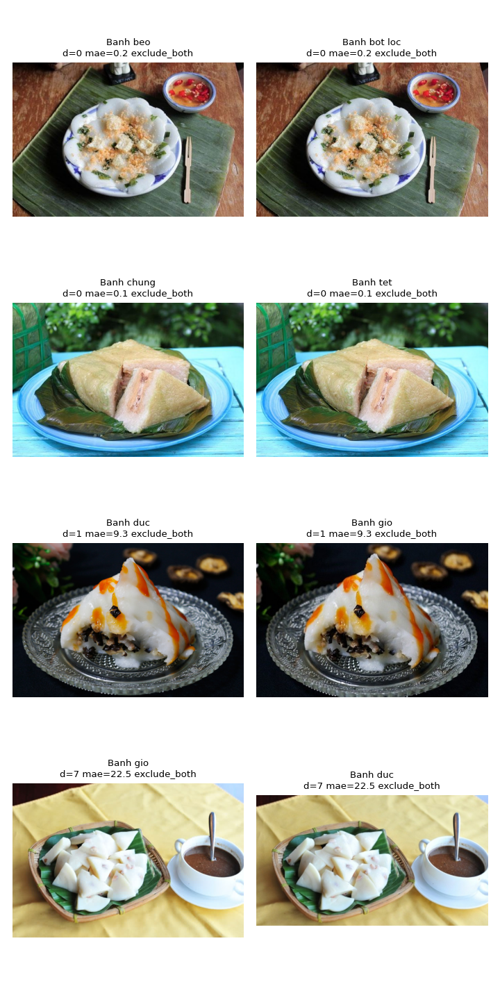
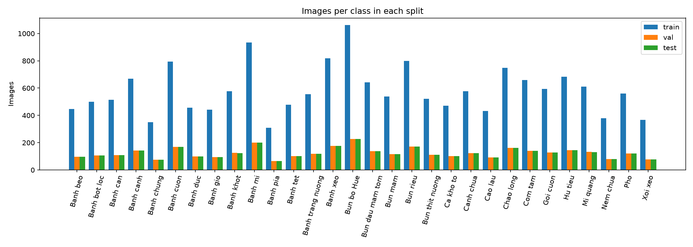
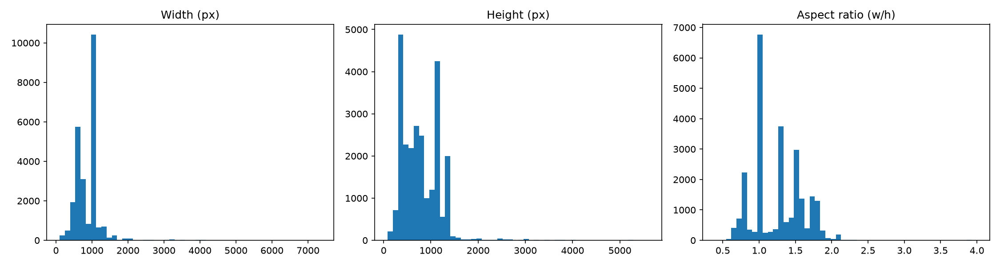
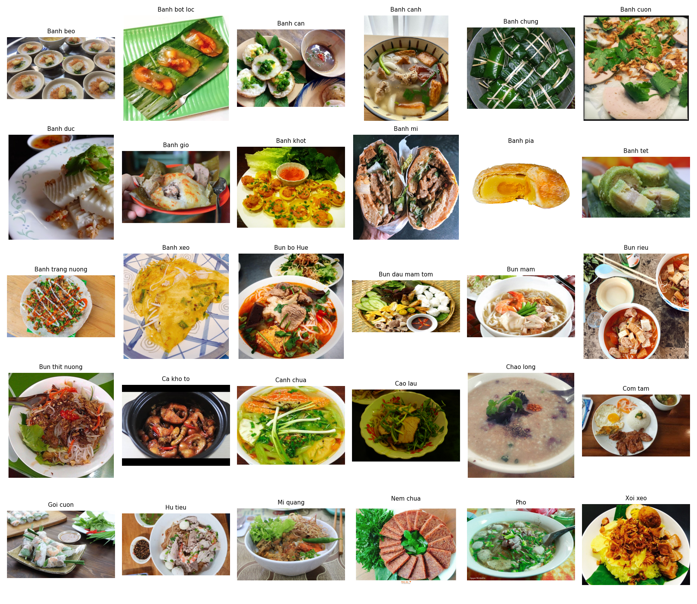
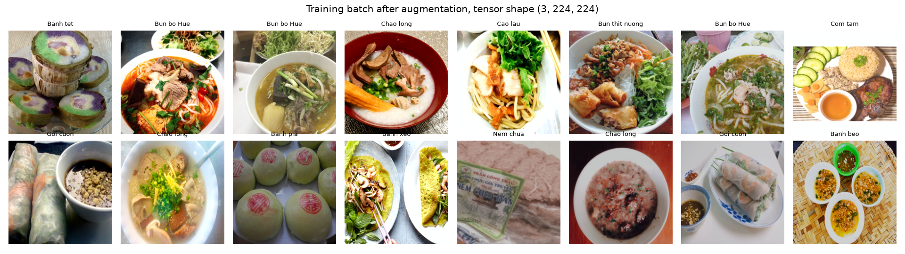
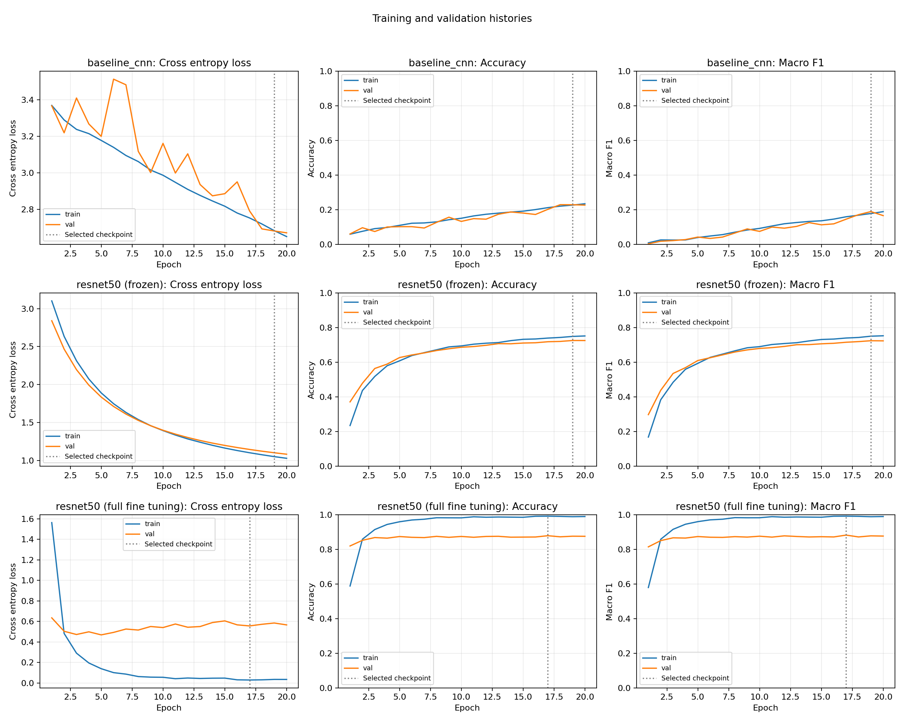
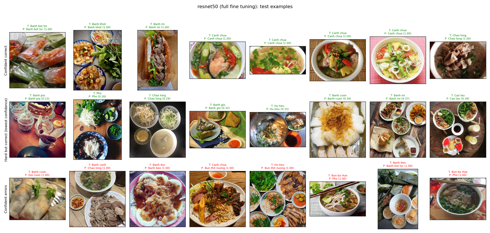
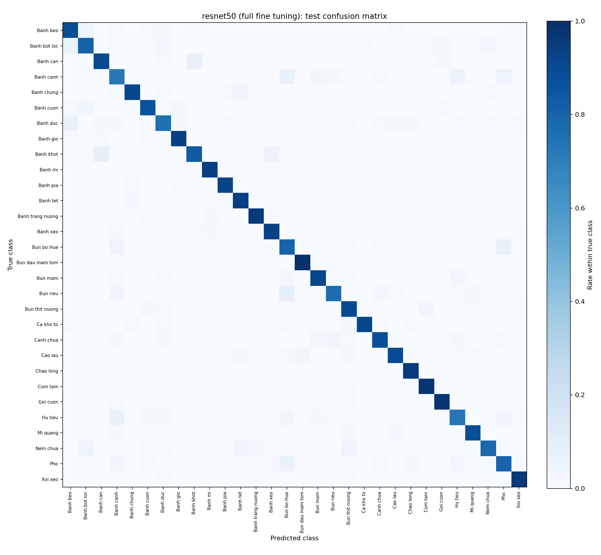
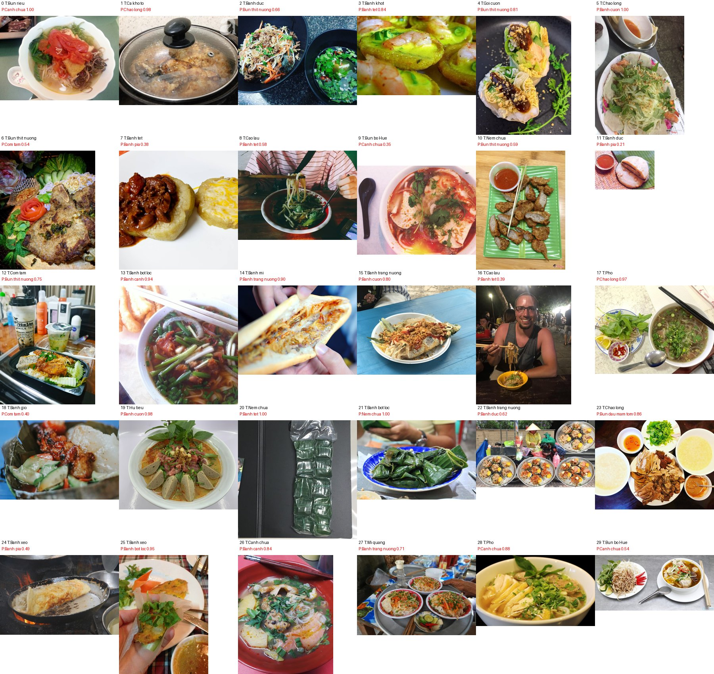

# Assignment 2 — M3 Final Report: Vietnamese Food Recognition

Group 09 - Ryzen9 · CO3133 Semester 261 · Track: image classification.
The LaTeX version of this report is [`assignment2.tex`](../../assignment2.tex) at the
repository root. All numbers below come from the three final Kaggle runs in
[`results/kaggle/`](../results/kaggle/).

## 1. Problem and Data Description

### 1.1 Problem formulation

Food delivery, review and nutrition apps need to know which dish is in a photo.
ImageNet has no Vietnamese dish classes, many dishes look alike in a bowl, and
the same dish varies by region, vendor and plating.

- **Task:** single-label, 30-class image classification; one label per photo.
- **Input:** RGB image `x ∈ R^{3×224×224}`, normalized with ImageNet statistics.
- **Output:** 30 raw logits `z = f_θ(x)`; prediction `ŷ = argmax_k softmax(z)_k`.
- **Loss:** mean cross-entropy on raw logits, `L = -(1/n) Σ log p̂_{i,y_i}`.
- **Primary metric:** Macro-F1 (classes are imbalanced); accuracy is secondary.

Research questions:

- **Experiment A:** does an ImageNet-pretrained ResNet-50 beat a CNN trained
  from scratch on about 17,500 training images?
- **Experiment B (controlled):** with everything else fixed, does updating the
  whole backbone improve validation Macro-F1 over a frozen backbone, and at
  what extra cost?

Main difficulties: fine-grained classes (noodle soups, leaf-wrapped cakes),
large intra-class variation, background clutter and multi-dish photos, class
imbalance (441–1,517 images per class), web duplicates that can leak across
splits, and a single-GPU compute budget.

### 1.2 Dataset

| Property | Value |
| --- | --- |
| Dataset | 30VNFoods, Kaggle [`quandang/vietnamese-foods`](https://www.kaggle.com/datasets/quandang/vietnamese-foods), version 11 (audited 03 Oct 2026) |
| License | CC BY-NC-SA 4.0 on Kaggle; the archive also has an MIT `LICENSE` file. The stricter terms apply; images are not redistributed. |
| Collection / labels | Scraped from the web (source URLs per class); one dish label per image from its folder name |
| Samples | 25,136 original, all readable; 24,982 retained after the audit |
| Official split | 17,581 / 2,515 / 5,040 (not used, see 1.5) |
| Storage / formats | 4.48 GB ZIP, median file 127 KB; named `.jpg` but 24,854 JPEG, 119 PNG, 7 MPO, 2 BMP (opened by content, converted to RGB) |

**Dataset proposal:** submitted at M1 with name, source, version, license, task,
sample counts, preliminary distribution, split plan and split unit, metrics,
baseline plan, candidate pretrained models (EfficientNet-B0, ResNet-50,
ConvNeXt-Tiny, ViT-B/16, MobileNetV3-Large) and a compute estimate.
**Status: Approved** by the instructor. ResNet-50 was selected among the
candidates; the provisional split counts were replaced after duplicate review.
The dataset meets the handbook thresholds (30 ≥ 5 classes, 17,486 ≥ 5,000
training images, at least 309 training and 66 test images per class).

### 1.3 Data quality audit

| Step | Images |
| --- | ---: |
| Images in the archive (none unreadable) | 25,136 |
| Redundant exact copies, same label (one kept) | −25 |
| Exact copies with conflicting labels (all removed) | −79 |
| Near copies with conflicting labels, removed after review (25 pairs) | −50 |
| **Retained** | **24,982** |

Exact copies: SHA-256. Near copies: 64-bit dHash, Hamming distance ≤ 8
(1,718 candidate pairs), confirmed only when the 32×32 grayscale thumbnail
difference is ≤ 30/255 (without this, plate layouts chained into groups of 250+
images; with it the largest group has 9). 480 same-label pairs form 412 duplicate
groups. Of 54 cross-label pairs, 25 were one picture under two dishes (removed)
and 29 were different dishes (kept). Decisions are in
`data/manifests/audit.csv` and `duplicate_review.csv`.

**Bias and limitations:** nearly half the URLs are Instagram, Facebook or Foody
reviews (styled photos); label noise on unique images remains; some pairs (Banh
duc / Banh gio, Bun rieu / Bun mam) are hard even for people; heavily edited
copies can escape the hash checks; only 30 dishes are covered.

### 1.4 Exploratory data analysis

- **Class distribution:** Bun bo Hue 1,517 (largest), Banh pia 441 (smallest),
  ratio **3.44**; mean 833, median 797 (CV 0.30); top 5 classes hold 25.2%,
  bottom 5 hold 10.5%; entropy 0.988 of the balanced maximum. The smallest test
  class has 66 images (one error = 1.5 recall points). No class weights or
  resampling are used; Macro-F1 handles the imbalance in evaluation.
- **Input size:** median 1,000 × 720 px (4:3); widths 100–7,360 px, heights
  83–5,616 px; 14,180 landscape, 6,874 square, 3,928 portrait; 346 images (1.4%)
  have a short side below 224 px and are upscaled.
- **Representative samples:** noodle soups share bowls and broths; Banh chung,
  Banh tet and Banh gio share banana-leaf wrapping. For error analysis only, the
  classes are grouped into five visual families: noodle bowls (10), steamed and
  leaf-wrapped cakes (7), griddle cakes (4), rice dishes (3), breads, rolls and
  others (6).

### 1.5 Data splitting

The official split is not used because 197 duplicate groups and 40 identical
files cross its folders. All retained images are pooled and re-split ~70/15/15
with **seed 42**. The **split unit is the duplicate group**; within each class,
groups are shuffled, test is filled to ~15%, then validation, and the rest goes
to training. No subset rules: all 30 classes and all 24,982 images are used.

| Split | Images | Duplicate groups | Share | Purpose |
| --- | ---: | ---: | ---: | --- |
| Train | 17,486 | 17,161 | 70.0% | Parameter learning |
| Validation | 3,749 | 3,685 | 15.0% | Early stopping, checkpoint and experiment selection |
| Test | 3,747 | 3,688 | 15.0% | Final evaluation, once per run |

No image IDs, duplicate groups or SHA-256 hashes are shared across splits.
Normalization uses fixed ImageNet constants, so nothing is fitted on
validation or test images. Every run records the manifest SHA-256 hashes.

### 1.6 Preprocessing

| Applies to | Transforms |
| --- | --- |
| Labels | Folder names mapped alphabetically to 0–29 (`class_to_idx.json`) |
| Train | `RandomResizedCrop(224, scale=(0.7, 1.0))`, `RandomHorizontalFlip()`, `ColorJitter(0.2, 0.2, 0.2)` |
| Val / test | `Resize(232)`, `CenterCrop(224)`, as in TorchVision `ResNet50_Weights.IMAGENET1K_V2` |
| All splits | RGB, `ToTensor()`, `Normalize` with ImageNet mean (0.485, 0.456, 0.406) and std (0.229, 0.224, 0.225) |
| Tensors | Images `[64, 3, 224, 224]` float32, labels `[64]` int64, logits `[64, 30]` |

The training loader shuffles with a seeded generator and seeds each worker;
incomplete final batches are kept.

## 2. Methodology

### 2.1 Pipeline

Raw images + audited manifests → resize / crop / augment / normalize →
DataLoader (batch 64) → scratch CNN or ResNet-50 → logits → cross-entropy →
Adam (AMP FP16) → arg-max prediction → index-to-dish-name mapping →
Macro-F1, accuracy, cost and error analysis. Validation runs after every epoch
in FP32 without gradients.

### 2.2 Models

| | Scratch CNN (baseline) | Frozen ResNet-50 | Full ResNet-50 |
| --- | --- | --- | --- |
| Architecture | 33 plain convs in 5 stages (1, 6, 8, 12, 6 convs; 64→512 channels), BatchNorm + ReLU, stride-2 downsampling to 7×7, global average pooling, 512→256→30 head | Bottleneck residual blocks, global average pooling, `Linear(2048, 30)` head | same |
| Initialization | Random | `IMAGENET1K_V2` backbone, random head | same |
| Trained part | All layers | Head only | All layers |
| Total parameters | 21,249,886 | 23,569,502 | 23,569,502 |
| Trained parameters | 21,249,886 | 61,470 | 23,569,502 |
| Strength | No external data; shows what the training set alone provides | Lowest training cost, low overfitting risk | Features adapt to the food domain |
| Limit | Deep plain stack without residual connections is hard to optimize | ImageNet features are fixed and contain no Vietnamese dishes | 383× more trained parameters; overfitting risk |

CNN shapes: `3×224×224 → 64×112×112 → 64×56×56 → 128×28×28 → 256×14×14 → 512×7×7`.
ResNet blocks compute `y = F(x) + x`, so deep stacks stay trainable.

**Fine-tuning procedure.** *Frozen:* backbone `requires_grad = False` and kept in
eval mode, so BatchNorm running statistics stay at their ImageNet values.
*Full:* all layers trainable; BatchNorm statistics adapt. Adam receives only
trainable parameters at learning rate 1e-4 (10× lower than the scratch CNN) with
no warm-up or layer-wise rates. Both regimes share the same pretrained weights and
seeded head initialization.

**Loss and metrics.** Cross-entropy without class weights or label smoothing.
Macro-F1 = mean of the 30 per-class F1 scores (an undefined F1 counts as 0);
accuracy, per-class precision/recall/F1 and the confusion matrix support analysis.

**Implemented by the group:** data audit and group-aware split, manifest dataset,
scratch CNN, ResNet-50 wrapper and freezing logic, training loop (AMP, early
stopping, resume), checkpoint selection and reload verification, evaluation,
error analysis, inference benchmark and plots. **Libraries:** PyTorch (layers,
Adam, cross-entropy, autocast/GradScaler, DataLoader), TorchVision (ResNet-50
weights, transforms), scikit-learn (metrics, confusion matrix), Pillow and NumPy.

### 2.3 Training setup

| Setting | Value |
| --- | --- |
| Optimizer | Adam, weight decay 0 |
| Learning rate | 1e-3 (scratch CNN), 1e-4 (both ResNet-50); constant, no scheduler |
| Batch size / max epochs | 64 / 20 |
| Early stopping | Patience 5 on validation Macro-F1 (no run stopped early) |
| Checkpoint | Highest validation Macro-F1; ties keep the earlier epoch |
| Regularization | Augmentation only; no weight decay, dropout or label smoothing |
| Seed | 42 (Python, NumPy, PyTorch, loader generator) |
| Precision | AMP FP16 + GradScaler for training; FP32 validation and test |
| Data loading | 4 workers, persistent, prefetch 2, pinned memory |
| Hyperparameter search | None |

After training, each selected checkpoint is reloaded and must reproduce its saved
validation accuracy and Macro-F1 exactly before the test split is evaluated; all
three runs passed (`matches_saved_metrics: true`).

**Environment:** one Kaggle Tesla T4 (14.6 GB), 4 CPU cores, Python 3.13.16,
PyTorch 2.11.0+cu130, TorchVision 0.26.0+cu130, CUDA 13.0, cuDNN 9.27.0,
NumPy 2.1.3, pandas 2.3.3, scikit-learn 1.6.1. Channels-last and cuDNN benchmark
are on, so reruns are not bit-identical; all compared runs use the same options.
The earlier M2 runs (local RTX 5070 Ti, FP32, no early stopping) are not compared.

| Run | Run ID | Epochs | Training time |
| --- | --- | ---: | ---: |
| Scratch CNN | `20261103T145419Z_7a003524` | 20 | 65 min 13 s |
| Frozen ResNet-50 | `20261103T160427Z_d37a574f` | 20 | 55 min 28 s |
| Full ResNet-50 | `20261103T170311Z_ce0f6099` | 20 | 60 min 28 s |

Training time covers the epoch loop (training, validation, data loading and
checkpoint saving) and excludes setup and weight download.

### 2.4 Experimental design

| | A: baseline vs pretrained | B: frozen vs full fine-tuning (controlled ablation) |
| --- | --- | --- |
| Hypothesis | ImageNet features transfer to food photos, so pretrained ResNet-50 beats a scratch CNN on ~17,500 images | Adapting the whole backbone beats a fixed ImageNet feature extractor |
| Changed factor | Architecture and initialization (learning rate also differs) | `freeze_backbone` only |
| Fixed factors | Manifests, seed, preprocessing and augmentation, loss, optimizer, batch size, epoch budget, early stopping, AMP, GPU type | Everything in A + architecture, pretrained weights, seeded head init, LR 1e-4 |
| Metrics | Val and test Macro-F1 (primary), accuracy | Same + trained parameters, training time, inference cost |
| Comparison | Δ validation Macro-F1 = frozen − CNN; gain not attributed to one factor | Δ validation Macro-F1 = full − frozen, reported with the extra cost |

Decisions use validation only; the test split is scored once per run after the
checkpoint is fixed. **Compute cost** is measured as parameters, checkpoint size,
training time, model-only inference (synthetic inputs, batch 1 and 64, FP32 and
AMP FP16, 10 warm-up + 50 timed iterations) and one end-to-end FP32 pass over the
test split (decoding, transforms and transfer included).

## 3. Implementation Results

### 3.1 Training behavior

Selected epochs: 19 (CNN), 19 (frozen), 17 (full). No run stopped early.

- **Scratch CNN underfits.** Train and validation accuracy stay near 23% (23.5%
  vs 22.7% at epoch 20); validation loss fluctuates (3.22 → 3.41 at epoch 3,
  3.51 at epoch 6); both curves are still rising at epoch 20.
- **Frozen ResNet-50 converges smoothly.** Validation Macro-F1 0.298 → 0.724;
  small gap (75.2% vs 72.6% accuracy at epoch 20); still gaining ~0.004 per epoch.
- **Full ResNet-50 overfits after a fast start.** Validation Macro-F1 0.815 after
  one epoch, plateau near 0.87 from epoch 3; training accuracy 99.2% while
  validation loss rises from 0.469 (epoch 5) to ~0.57. Only +0.008 after epoch 5.

**Implementation issues and fixes.** The M2 runs showed low GPU utilization, so
the final runs added AMP, channels-last, persistent workers with prefetch, early
stopping and resumable checkpoints, and moved to Kaggle. The loader is still the
bottleneck: from epoch 2 on, 84–114 s of each 155–205 s epoch is spent waiting for
data, and mean training throughput is 116–128 images/s for all three models
regardless of size. The first CNN epoch took 764.5 s (590.1 s waiting for data),
most likely worker start-up and the first read of the mounted dataset.

### 3.2 Quantitative results

| Model | Epoch | Val Acc | Val Macro-F1 | Test Acc | Test Macro-F1 | Test errors |
| --- | ---: | ---: | ---: | ---: | ---: | ---: |
| Scratch CNN | 19 | 22.94% | 0.1898 | 23.30% | 0.1885 | 2,874 |
| Frozen ResNet-50 | 19 | 72.58% | 0.7245 | 71.92% | 0.7179 | 1,052 |
| Full ResNet-50 | 17 | **87.89%** | **0.8824** | **87.80%** | **0.8787** | **457** |

Validation and test Macro-F1 differ by < 0.007 for every model, so checkpoint
selection did not overfit the validation split. For both ResNet-50 runs,
accuracy and Macro-F1 stay within 0.01. One seed per configuration, so no
mean ± std. Source: [final_comparison.csv](../results/final_comparison.csv).

### 3.3 Compute cost

| Measure | Scratch CNN | Frozen ResNet-50 | Full ResNet-50 |
| --- | ---: | ---: | ---: |
| Trained / total parameters | 21.25 M / 21.25 M | 0.06 M / 23.57 M | 23.57 M / 23.57 M |
| Checkpoint size | 243.4 MB | 90.7 MB | 270.2 MB |
| Training time | 65.2 min | 55.5 min | 60.5 min |
| Mean epoch time, epoch 2 on | 165.7 s | 165.9 s | 180.6 s |
| Training throughput | 127.4 img/s | 127.7 img/s | 116.4 img/s |
| Latency, batch 1, FP32 | 8.73 ms | 8.25 ms | 8.27 ms |
| Latency, batch 1, AMP FP16 | 3.24 ms | 6.73 ms | 5.88 ms |
| Throughput, batch 64, FP32 | 324 img/s | 242 img/s | 243 img/s |
| Throughput, batch 64, AMP FP16 | 1,534 img/s | 807 img/s | 804 img/s |
| Peak memory, batch 64, FP32 | 521 MB | 777 MB | 777 MB |
| End-to-end test throughput, FP32 | 22.3 img/s | 102.3 img/s | 101.3 img/s |

Both ResNet-50 variants share one architecture, so inference cost is equal;
checkpoint size differs only because each file stores Adam state for the
trained parameters. The CNN's low end-to-end throughput contradicts its
model-only speed, so it reflects data loading (most likely the first, cold read
of the test images), not the model; this was not profiled.

### 3.4 Qualitative results

Rows: confident correct, low-confidence correct and confident wrong test
predictions of Full ResNet-50 (T = true, P = predicted). Confident correct
predictions are close-ups of one dish; low-confidence correct ones are mostly
table scenes with several dishes; confident errors fall between lookalike
dishes (Bun bo Hue / Pho, Banh cuon / Goi cuon) and on mixed platters where
another dish dominates. These are illustrative, not representative.

### 3.5 Comparison and discussion

| Experiment | Val gain | Test gain | Verdict |
| --- | ---: | ---: | --- |
| A: CNN → Frozen ResNet-50 | +0.5347 | +0.5294 | Supported, but not attributable to one factor |
| B: Frozen → Full ResNet-50 | +0.1579 | +0.1608 | Supported; full fine-tuning is better on all 30 classes |

**Where the differences appear.** Full fine-tuning improves all 30 classes. The
largest test F1 gains are on noodle soups and lookalike cakes: Banh duc +0.39
(0.36 → 0.75), Bun rieu +0.31, Bun mam +0.30, Hu tieu +0.30, Mi quang +0.27, Pho
+0.25. Distinctive dishes (Banh mi, Banh beo, Ca kho to, Bun dau mam tom) already
exceed 0.82 F1 when frozen and gain ≤ 0.05. The scratch CNN collapses toward the
largest class: 8 of its 10 most frequent confusions predict Bun bo Hue (e.g. 84
of 171 Bun rieu images), five classes (Banh can, Banh canh, Banh duc, Bun mam,
Cao lau) score 0 F1, and 2,845 of its 2,874 errors have confidence < 0.5.

**Likely causes.**

- *Data scale and initialization:* ~17,500 images and 20 epochs are too few for a
  21 M-parameter plain CNN to learn food features from scratch.
- *Fixed features limit the frozen model:* noodle soups differ in broth colour,
  noodle shape and toppings, which generic ImageNet features keep close together.
- *Backbone adaptation drives the full model:* updating every layer (and
  BatchNorm statistics) learns these cues; without weight decay it also memorizes
  the training set (99% training accuracy).
- *Class imbalance is not the main factor:* accuracy and Macro-F1 stay within
  0.01, and the weakest classes are not the smallest ones.

**Trade-offs.** Full fine-tuning trains 383× more parameters than frozen but takes
only 9% longer (60.5 vs 55.5 min), because both pass every image through the full
backbone and data loading dominates; inference speed is identical, only the
checkpoint grows (270 vs 91 MB). The CNN is fastest at inference (1,534 img/s,
~1.9× ResNet-50) but reaches only 0.19 Macro-F1.

**Not yet supported.** One seed per configuration, so variance is unknown and
small gaps (e.g. +0.008 after epoch 5) are not meaningful; Experiment A changes
model, initialization and learning rate together; a longer CNN schedule or full
fine-tuning with weight decay could change the margins (not tested); Kaggle
timings are indicative.

Per-class test F1 (all 30 classes)

| Class | Scratch CNN | Frozen | Full | Support |
| --- | ---: | ---: | ---: | ---: |
| Banh beo | 0.220 | 0.828 | 0.850 | 96 |
| Banh bot loc | 0.029 | 0.640 | 0.811 | 107 |
| Banh can | 0.000 | 0.758 | 0.884 | 110 |
| Banh canh | 0.000 | 0.492 | 0.705 | 143 |
| Banh chung | 0.268 | 0.761 | 0.907 | 75 |
| Banh cuon | 0.282 | 0.767 | 0.888 | 170 |
| Banh duc | 0.000 | 0.362 | 0.747 | 98 |
| Banh gio | 0.118 | 0.811 | 0.927 | 95 |
| Banh khot | 0.120 | 0.753 | 0.863 | 124 |
| Banh mi | 0.541 | 0.926 | 0.952 | 200 |
| Banh pia | 0.379 | 0.850 | 0.917 | 66 |
| Banh tet | 0.162 | 0.840 | 0.923 | 102 |
| Banh trang nuong | 0.389 | 0.862 | 0.946 | 119 |
| Banh xeo | 0.494 | 0.818 | 0.927 | 176 |
| Bun bo Hue | 0.297 | 0.634 | 0.804 | 228 |
| Bun dau mam tom | 0.212 | 0.913 | 0.961 | 137 |
| Bun mam | 0.000 | 0.587 | 0.887 | 116 |
| Bun rieu | 0.071 | 0.523 | 0.834 | 171 |
| Bun thit nuong | 0.048 | 0.652 | 0.842 | 112 |
| Ca kho to | 0.270 | 0.898 | 0.939 | 101 |
| Canh chua | 0.104 | 0.648 | 0.885 | 123 |
| Cao lau | 0.000 | 0.784 | 0.877 | 92 |
| Chao long | 0.252 | 0.705 | 0.948 | 161 |
| Com tam | 0.192 | 0.792 | 0.968 | 141 |
| Goi cuon | 0.279 | 0.878 | 0.954 | 128 |
| Hu tieu | 0.208 | 0.473 | 0.770 | 146 |
| Mi quang | 0.137 | 0.630 | 0.899 | 131 |
| Nem chua | 0.088 | 0.688 | 0.829 | 81 |
| Pho | 0.236 | 0.526 | 0.777 | 120 |
| Xoi xeo | 0.260 | 0.735 | 0.938 | 78 |

### 3.6 Error analysis

Full ResNet-50 misclassifies **457 of 3,747** test images (12.2%). Errors are
grouped by the visual families of the true and predicted classes.

| Error group | Errors | Most frequent pairs (true → predicted) | Hypothesized cause | Improvement idea |
| --- | ---: | --- | --- | --- |
| Noodle soups | 185 (40.5%) | Bun bo Hue → Pho 17; Bun rieu → Bun bo Hue 15; Hu tieu → Banh canh 10 | Shared broth, herbs, plating; noodle thickness and broth colour are small cues at 224 px | Higher resolution; more training images for these classes |
| Across families | 183 (40.0%) | Bun rieu → Canh chua 5; Nem chua → Bun thit nuong 4; Banh xeo → Banh mi 4 | Multi-dish scenes, unusual views, shared components vs. a single label | Crop to the main dish; clean doubtful labels |
| Steamed cakes | 54 (11.8%) | Banh bot loc → Banh beo 7; Banh duc → Banh beo 7; Banh cuon → Banh bot loc 6 | White, translucent rice-flour textures; similar plating | Less colour jitter; hard examples |
| Griddle cakes | 28 (6.1%) | Banh khot ↔ Banh can 18; Banh khot → Banh xeo 7 | Small round cakes from the same moulds | Higher resolution; crops that keep scale cues |
| Other within family | 7 (1.5%) | Scattered pairs | No clear pattern | — |

By true family, the error rate is highest for noodle soups (16.9%) and steamed
cakes (13.2%) and lowest for rice dishes (3.4%). Confusions are often mutual
(Bun bo Hue ↔ Pho 17/8, Banh canh ↔ Bun bo Hue 10/11, Banh can ↔ Banh khot 8/10),
which points to fine-grained similarity rather than a one-sided bias. Weakest
classes: Banh canh (F1 0.705), Banh duc (0.747), Hu tieu (0.770), Pho (0.777).

**Cross-family sample review** (30 random errors, seed 0): multi-dish or
cluttered scenes 8, unusual view or cooking stage 8, soups from another family 8,
shared wrapping or components 4, doubtful labels 2.

**Confidence of errors.**

| Test errors | Scratch CNN | Frozen | Full |
| --- | ---: | ---: | ---: |
| Total | 2,874 | 1,052 | 457 |
| Confident (≥ 0.8) | 1 | 7 | 225 |
| Moderate (0.5–0.8) | 28 | 99 | 179 |
| Uncertain (< 0.5) | 2,845 | 946 | 53 |
| True class in top 3 | 763 | 661 | 321 |
| Mean true-class probability | 0.063 | 0.131 | 0.094 |

Full ResNet-50 is often confidently wrong (49% of errors ≥ 0.8), but the true
class is in its top 3 for 70% of errors; temperature scaling or label smoothing
could make confidence a usable reject signal, and top-3 output would recover most
mistakes in a search or tagging app. Across models, 753 test images are wrong for
none, 1,909 for one, 781 for two and **304 for all three** (mostly Banh canh 32,
Bun rieu 27, Hu tieu 26, Banh duc 21); these should be inspected for ambiguity or
label noise before any relabelling.

### 3.7 Ablation study

Experiment B removes one component, updating the pretrained backbone, with
everything else fixed.

| Measure | Frozen | Full | Full − frozen |
| --- | ---: | ---: | ---: |
| Validation Macro-F1 | 0.7245 | 0.8824 | +0.1579 |
| Test Macro-F1 | 0.7179 | 0.8787 | +0.1608 |
| Validation accuracy | 72.58% | 87.89% | +15.31 pp |
| Test accuracy | 71.92% | 87.80% | +15.88 pp |
| Trained parameters | 61,470 | 23,569,502 | +23,508,032 |
| Training time | 55.5 min | 60.5 min | +5.0 min |
| Selected epoch | 19 | 17 | −2 |
| Inference, batch 64, AMP | 807 img/s | 804 img/s | ≈ 0 |

Full fine-tuning improves validation Macro-F1 by **+0.1579**, and the test
gain confirms it. The extra cost is +9%
training time, equal inference speed and a larger checkpoint. The conclusion
holds for one learning rate, no weight decay and 20 epochs; layer-wise learning
rates and gradual unfreezing were not tested.

### 3.8 Limitations and conclusion

**Limitations.**

- *Data:* styled web photos dominate; label noise on unique images remains;
  heavily edited copies may still leak.
- *Method:* the single-label setup cannot handle multi-dish photos; full
  fine-tuning overfits without weight decay and is poorly calibrated.
- *Experiment:* one run per configuration (seed 42), per-class test supports of
  66–228 images; validation drives stopping, selection and the experiment
  decision, so validation scores are slightly optimistic; Experiment A does not
  isolate one factor; the shared 20-epoch budget favours pretrained models.
- *Generalization:* only 30 dishes; results may not hold for everyday phone photos
  or regional variants missing from the data.

**Conclusion.** ImageNet pretraining is essential at this data scale, and full
fine-tuning is clearly worth its cost: **Full ResNet-50 reaches test Macro-F1
0.8787 and accuracy 87.80%**, against 0.7179 (frozen) and 0.1885 (scratch CNN).
Remaining errors concentrate on lookalike noodle soups and steamed cakes and on
multi-dish photos.

**Future work.** Repeat each configuration over ≥ 3 seeds (mean ± std); add
weight decay and stop near the epoch-5 plateau; test higher input resolution;
crop to the main dish, calibrate confidence and return top-3 predictions; profile
and speed up data loading.

## AI Usage Disclosure

| Entry | Tool / model | Member (verifier) | Stage and scope | Verification |
| --- | --- | --- | --- | --- |
| A2-1 | Codex (OpenAI), GPT-6 | Tran Manh Thang (2353124) | Setup and M2: file skeleton review; Docker, configuration, seeding, training runner, checkpoint verification, comparison/plot export, CI; M2 README, report and page drafts | Docker CPU suite passed 25 tests; M2 checkpoints reloaded and reproduced their validation metrics |
| A2-2 | Claude (Anthropic), Opus 5.5 | Phan Tan Loc (2352712) | M2: data audit, duplicate grouping, group-aware split, loaders, EDA notebook and figures | Unit tests in `tests/test_dataset.py`, `test_split.py`; 54 cross-label pairs reviewed by hand; no shared IDs, groups or hashes across splits |
| A2-3 | Claude (Anthropic), Opus 5.5 | Hoang Kim Cuong (2352145) | M2: scratch CNN, ResNet-50 wrapper, trainer, checkpoint helper, metrics, evaluator | Unit tests in `tests/test_models.py`, `test_metrics.py`, `test_checkpoint.py`; reloaded checkpoints reproduced saved metrics |
| A2-4 | Claude (Anthropic), Opus 5.5 | Hoang Kim Cuong (2352145) | M3: results, discussion, error analysis and limitations on the page; final figures and comparison CSV; this report and `assignment2.tex` | Every number traced to `summary.json`, `evaluation_*.json`, `inference_benchmark.json`, `history.json`, `per_class_test.csv`, `predictions_test.csv` in `results/kaggle/` |

Code examples were adapted and integrated by the members; no labels, data or
results were generated by AI. Final metrics, curves, confusion matrices and
prediction examples come from executed runs. Each member verified the AI-assisted
work in their area. Full log: [AI_USAGE.md](../../AI_USAGE.md#assignment-2).
