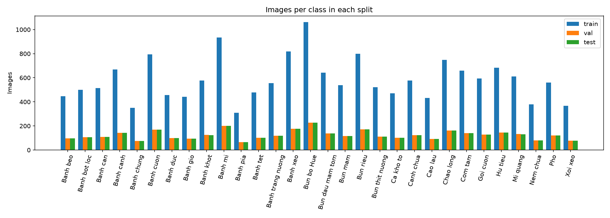
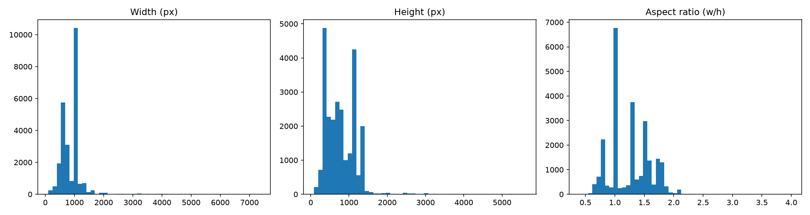
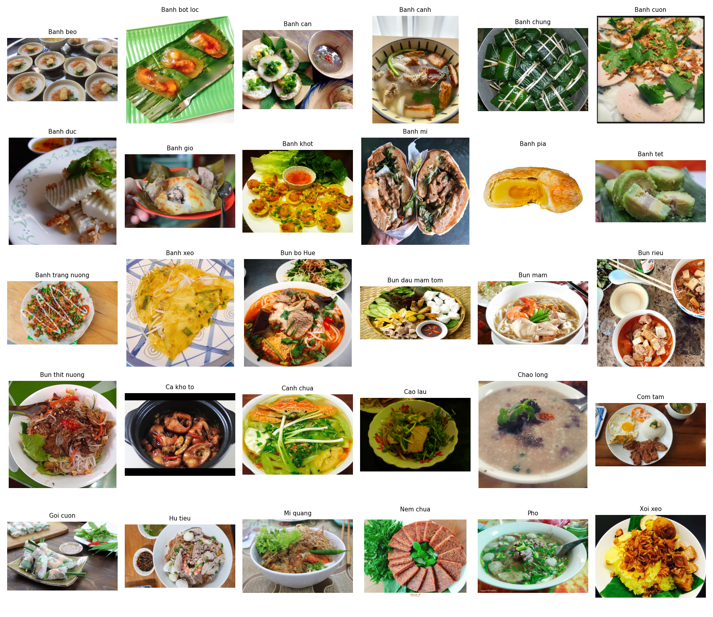
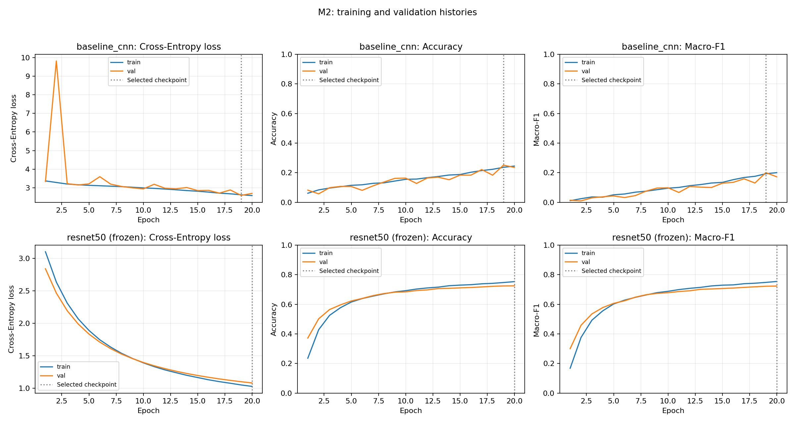

# Assignment 2 — M2 Draft

## Problem and Data Description

### Task

Recognize Vietnamese dishes from photographs using single-label
classification across 30 food categories.

Each input is an RGB image transformed to 224 × 224 pixels. The model
outputs 30 class logits; the largest logit determines the predicted dish.
Challenges include visually similar dishes, varied preparation, lighting,
backgrounds and class imbalance.

### Dataset

We use 30VNFoods from Kaggle, version 11:

https://www.kaggle.com/datasets/quandang/vietnamese-foods

The original package contains 25,136 images across 30 classes. Class labels
come from the food-category folders.

The proposal records CC BY-NC-SA 4.0 on the Kaggle page and an MIT LICENSE
file in the downloaded package. Both records are preserved; the package
license is not assumed to replace the dataset license.

### Audit and Cleaning

The saved audit records all 25,136 images as readable. Cleaning retained
24,982 images:

| Exclusion reason | Images excluded |
| --- | ---: |
| Redundant exact copies with the same label | 25 |
| Exact copies with conflicting labels | 79 |
| Near-duplicates excluded after review | 50 |
| Total excluded | 154 |

Exact duplicates were identified using SHA-256. Near-duplicate candidates
were identified using perceptual similarity checks, with label-conflicting
pairs reviewed manually. Decisions and reasons are recorded in
`data/manifests/audit.csv` and `duplicate_review.csv`.

### Data Splitting and Leakage Prevention

The original package partitions were pooled and re-split using seed 42.
Duplicate groups were kept together while approximately preserving class
proportions in a 70% / 15% / 15% allocation.

| Split | Images |
| --- | ---: |
| Training | 17,486 |
| Validation | 3,749 |
| Test | 3,747 |
| Total | 24,982 |

Checks on the final manifests found no image-ID or duplicate-group overlap
between splits. This reduces leakage risk but does not guarantee detection
of every transformed or otherwise unidentified duplicate.

Validation data is used for checkpoint selection. Test data remains
reserved for final evaluation.

### Exploratory Data Analysis

The original class counts range from 444 images for Banh pia to 1,530 for
Bun bo Hue, an imbalance ratio of approximately 3.45. Macro-F1 is the
primary metric because it gives each class equal weight.

Image resolutions and aspect ratios vary, requiring standardized
preprocessing. The EDA notebook documents distributions, examples and
duplicate-review findings.

### Data Limitations

Web-collected images may differ from everyday user photographs. Similar
dishes and remaining label noise can cause confusion. Duplicate detection
may miss heavily transformed copies, so residual leakage risk remains.

## Methodology

### Pipeline

Manifest CSV → RGB image loading → preprocessing → DataLoader →
model → cross-entropy loss → Adam optimization → validation →
checkpoint selection.

### Scratch CNN

The baseline is a group-implemented CNN with 33 convolutional layers,
BatchNorm and ReLU activations, spatial downsampling, global average
pooling, and a two-layer classification head.

It starts from random weights and outputs 30 raw logits. All 21,249,886
parameters are trainable.

### Pretrained ResNet-50

The pretrained model uses TorchVision ResNet-50 with
ResNet50_Weights.IMAGENET1K_V2. Its original classification layer is
replaced with a linear layer mapping 2,048 features to 30 logits.

The backbone is frozen, including its BatchNorm running statistics.
Only the new head's 61,470 parameters are optimized. The complete model
contains 23,569,502 parameters.

### Preprocessing

All images are converted to RGB.

Training preprocessing uses:
- Random resized cropping to 224 × 224, with crop scale 0.7–1.0.
- Random horizontal flipping.
- Brightness, contrast and saturation jitter of 0.2.
- Tensor conversion and ImageNet normalization.

Validation preprocessing resizes the shorter side to 232 pixels and
applies a 224 × 224 center crop, followed by the same normalization.

Normalization uses fixed ImageNet means (0.485, 0.456, 0.406) and standard
deviations (0.229, 0.224, 0.225), rather than statistics fitted on
validation or test images.

## Experimental Setup

### Shared Protocol

- Training / validation / test samples: 17,486 / 3,749 / 3,747.
- Both runs use identical manifest and class-mapping hashes.
- Seed: 42; Python, NumPy and PyTorch random generators are seeded.
- Batch size: 64; DataLoader workers: 2.
- Epoch budget: 20.
- Loss: cross-entropy applied to raw logits.
- Optimizer: Adam; weight decay: 0.
- No learning-rate scheduler, early stopping or mixed-precision training.
- Checkpoint criterion: highest validation Macro-F1; ties retain the
  earlier checkpoint.
- Test data is reserved for final evaluation.

| Setting | Scratch CNN | Frozen ResNet-50 |
| --- | --- | --- |
| Initialization | Random | ImageNet V2 backbone; random new head |
| Learning rate | 0.001 | 0.0001 |
| Trainable layers | Entire model | Classification head only |

These configurations compare the baseline with a pretrained approach.
They are not a single-factor controlled experiment.

### Environment and Reproducibility

- GPU: NVIDIA GeForce RTX 5070 Ti, approximately 16 GB VRAM.
- Python: 3.11.13.
- PyTorch: 2.7.1+cu128.
- TorchVision: 0.22.1+cu128.
- CUDA runtime: 12.8.
- Docker container shared-memory limit: 1 GB.

Each run saves its resolved configuration, source commit, manifest
hashes, class mapping, environment metadata, epoch history, selected
checkpoint and elapsed time. Selected checkpoints were reloaded and
their validation Accuracy and Macro-F1 reproduced.

## Preliminary Results

Both models were trained for 20 epochs using the same reviewed dataset
manifests, seed 42, and 224 × 224 RGB inputs. Checkpoints were selected by
highest validation Macro-F1. Reloading each selected checkpoint reproduced
its recorded validation Accuracy and Macro-F1.

| Model | Selected epoch | Validation Accuracy | Validation Macro-F1 | Trainable parameters | Elapsed time |
| --- | ---: | ---: | ---: | ---: | ---: |
| CNN trained from scratch | 19 | 25.10% | 0.2005 | 21,249,886 | 45m 15s |
| Pretrained ResNet-50, frozen backbone | 20 | 72.45% | 0.7231 | 61,470 | 45m 44s |

Elapsed time includes training, validation, data loading, and checkpoint
saving inside the epoch loop. It excludes initial setup and pretrained
weight downloading.

### Discussion

The frozen pretrained ResNet-50 configuration achieved 47.35 percentage
points higher validation Accuracy and 0.5227 higher Macro-F1 than the
scratch CNN in these runs.

The CNN improved throughout much of training, with fluctuating validation
metrics and a large validation-loss spike at epoch 2. Its highest validation
Macro-F1 occurred at epoch 19. Frozen ResNet-50 improved more smoothly and
achieved its highest validation Macro-F1 at epoch 20.

These results compare complete model configurations. They do not isolate
the effects of architecture, pretraining, or learning rate individually.
The controlled frozen-versus-full-fine-tuning comparison remains planned
for M3.

### Limitations and Remaining Work

- Results currently cover one seed and validation data only.
- The held-out test set has not been evaluated.
- Convergence beyond the 20-epoch budget has not been established.
- Similar elapsed times do not establish a performance bottleneck;
  throughput profiling is deferred until after M2.
- Full fine-tuning and detailed error analysis remain pending.

### Evidence

- [Comparison CSV](../results/comparison.csv)
- CNN run: `20261025T103059Z_a86f4102`
- Frozen ResNet run: `20261025T112235Z_014bbc02`
- Recorded training source commit:
  `5d106abab40a6720ebc5874b9a748f01356c965c`

## Reproduction

See the [environment and reproduction guide](../docs/environment.md)
for dataset placement, Docker setup, training commands, checkpoint
verification, and figure/table generation.

## AI Usage Disclosure

- **OpenAI Codex, GPT-6:** Trần Mạnh Thắng (2353124) used incremental
  implementation guidance, debugging support and M2 writing/page assistance.
  The student executed tests and training; results were checked against saved
  artifacts and checkpoint-reload outputs.
- **Claude, Anthropic, Opus 5.5 (user-reported):** Hoang Kim Cuong (2352145)
  and Phan Tan Loc (2352712) used Claude for their Assignment 2 work, as reported
  by Trần Mạnh Thắng. Repository changes associate their work with
  models/training/evaluation and data/EDA respectively; each member must confirm
  exact AI scope, dates, prompts, student edits and personal verification steps.
- **Overall final verification responsibility:** Trần Mạnh Thắng (2353124),
  confirmed by the user. Existing historical website/EDA disclosures are preserved
  separately for group reconciliation.

See the [assignment AI-use log](../docs/ai_usage.md) and
[repository AI_USAGE.md](../../AI_USAGE.md). The teammate entries remain
drafts until their missing member-specific details are supplied.
